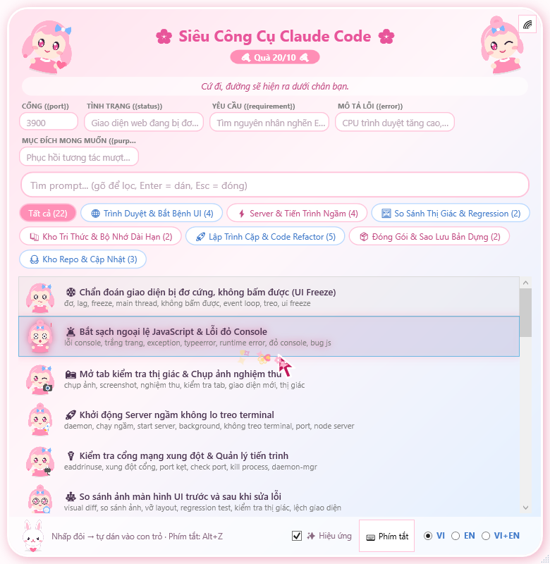
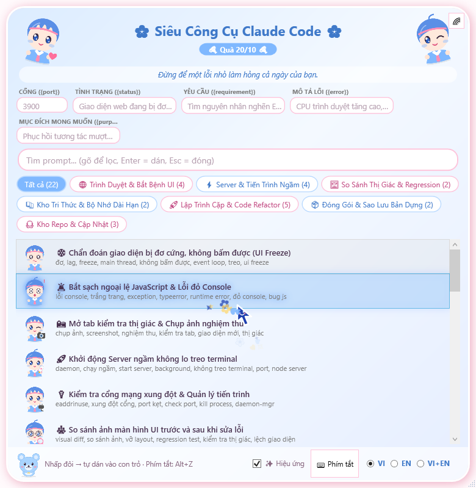

<div align="center">


# 🌸 Siêu Công Cụ Claude Code · Quà 20/10 🌸

**Popup prompt nổi cho Claude Code · dán thẳng vào con trỏ · chibi hồng & xanh**<br>
**Floating prompt popup for Claude Code · pastes right at your cursor · pink & blue chibi**

[](#)
[](#)
[](#)
[](#)
[](https://github.com/phamhuutienpro/Claude-SuperTools-1Click/commits/main)

### [🌐 Trang giới thiệu / Website](https://phamhuutienpro.github.io/Claude-SuperTools-1Click/) · [🇻🇳 Tiếng Việt](#-tiếng-việt) · [🇬🇧 English](#-english)

</div>

---

<a name="-tiếng-việt"></a>
## 🇻🇳 Tiếng Việt

### ⚡ Cài đặt chỉ với một dòng

Dán dòng này vào AI IDE (Claude Code, Cursor, Windsurf, Antigravity...). Không cần tải file trước:

```text
Đọc https://raw.githubusercontent.com/phamhuutienpro/Claude-SuperTools-1Click/main/INSTALL_PROMPT.md rồi làm đúng hướng dẫn trong đó để cài dự án https://github.com/phamhuutienpro/Claude-SuperTools-1Click cho tôi. Tự làm hết các bước, đọc script trước khi chạy, báo cáo song ngữ khi xong.
```

Bản đầy đủ nằm ở [INSTALL_PROMPT.md](INSTALL_PROMPT.md). Hoặc cài thủ công:

```powershell
git clone https://github.com/phamhuutienpro/Claude-SuperTools-1Click.git
cd Claude-SuperTools-1Click
.\Cai-Dat-1-Click.cmd
```

Trình cài đặt chép công cụ vào `%USERPROFILE%\.claude\tools`, tạo shortcut khởi động cùng Windows và chạy popup. Cài không bật popup: `Cai-Dat-1-Click.ps1 -NoPopup`.

### 🖼️ Giao diện

<table>
<tr>
<td align="center"><br><b>Theme hồng</b> · nhân vật nữ</td>
<td align="center"><br><b>Theme xanh</b> · nhân vật nam</td>
</tr>
</table>

### ✨ Tính năng

| | Chi tiết |
|---|---|
| ⌨️ **Mở / đóng** | `Alt+Z` (mặc định). Đổi ở nút **Phím tắt** hoặc menu icon khay |
| 📋 **Dán vào con trỏ** | Nhấp đôi prompt: tự copy, đóng popup, trả focus và dán |
| 🫥 **Không chiếm con trỏ** | Cửa sổ không giành focus; chỉ lấy focus khi bạn bấm vào ô nhập |
| 🧩 **5 ô tham số** | Cổng, Tình trạng, Yêu cầu, Mô tả lỗi, Mục đích; dùng chung và được ghi nhớ |
| 📚 **22 prompt** | Tab: trình duyệt, server, so sánh giao diện, kho tri thức, lập trình, đóng gói, kho repo |
| 🎨 **Hồng · Xanh** | Nút 🌈 đổi theme; chibi riêng cho từng prompt |
| 💬 **100 câu động lực** | VI / EN, đổi mỗi 120 giây, bấm để đổi câu |
| ✨ **Hiệu ứng chuột** | Vệt lấp lánh, nổ hạt khi bấm, thẻ phát sáng; tắt được ở ô **Hiệu ứng** |
| 🔔 **Khay hệ thống** | Đóng cửa sổ chỉ thu nhỏ về khay; tự chạy khi mở máy; nhắc phím tắt mỗi giờ |

### 🔄 Tự cập nhật nền

Sau khi cài, popup tự kiểm tra bản mới trên GitHub **khi mở máy và mỗi 24 giờ**. Có bản mới thì tự tải, tự cài và tự khởi động lại popup ở nền, **không hỏi bạn**; chỉ hiện một thông báo ngắn ghi chú thay đổi. Mỗi bản phát hành đã qua kiểm tra cú pháp và quét bí mật trước khi lên GitHub. Tắt ở menu khay: **Tự cập nhật nền**; kiểm tra ngay: **Kiểm tra cập nhật ngay**. Cùng lúc, các repo bạn đã cài từ kho cũng được cập nhật.

### 🐙 Kho repo & cập nhật

Danh sách các dự án của tác giả để bạn tự chọn cài và cập nhật. **Chỉ đọc**: bạn không có và không cần quyền sửa hay xóa gì trên GitHub của tác giả. Cần `git`, không cần đăng nhập GitHub.

```powershell
repo-store list                  # repo trong kho, đã cài / có bản mới chưa
repo-store install <id>          # tải về và chạy trình cài đặt tự động
repo-store update --all          # cập nhật an toàn, không ghi đè file bạn đã sửa
repo-store remove <id> --yes     # xóa bản tải về trên máy bạn
```

Trong popup có tab **Kho Repo & Cập Nhật** với 3 prompt để nhờ AI làm giúp. Kho chỉ chấp nhận link thuộc `github.com/phamhuutienpro`.

### 🛠️ Công cụ dòng lệnh

| Lệnh | Việc làm |
|---|---|
| `cdp-browse <url>` | Chẩn đoán trang web đơ, chụp ảnh, đọc lỗi console |
| `daemon-mgr start/list/kill` | Chạy server ngầm, xem cổng |
| `pkg-backup exe <file.js>` | Đóng gói app Node.js thành `.exe` |
| `visual-diff a.png b.png` | So sánh ảnh giao diện trước/sau |
| `knowledge-hub save/search` | Lưu và tra cứu bài học sửa lỗi |
| `repo-store ...` | Xem, cài, cập nhật repo trong kho |

### 🧪 Kiểm thử & gỡ cài đặt

```powershell
powershell -ExecutionPolicy Bypass -File Test-Tu-Dong.ps1   # popup hiện, giữ focus, dán đúng
```

Gỡ: chuột phải icon khay → **Thoát**; xóa `SieuCongCuClaudeCode.lnk` trong `shell:startup`; xóa file trong `%USERPROFILE%\.claude\tools` nếu muốn.

---

<a name="-english"></a>
## 🇬🇧 English

### ⚡ Install with a single line

Paste this into your AI IDE (Claude Code, Cursor, Windsurf, Antigravity...). No download needed:

```text
Read https://raw.githubusercontent.com/phamhuutienpro/Claude-SuperTools-1Click/main/INSTALL_PROMPT.md and follow it exactly to install https://github.com/phamhuutienpro/Claude-SuperTools-1Click for me. Do every step yourself, read scripts before running them, and report bilingually when done.
```

The full prompt is in [INSTALL_PROMPT.md](INSTALL_PROMPT.md). Or install manually:

```powershell
git clone https://github.com/phamhuutienpro/Claude-SuperTools-1Click.git
cd Claude-SuperTools-1Click
.\Cai-Dat-1-Click.cmd
```

The installer copies the tools into `%USERPROFILE%\.claude\tools`, creates a Startup shortcut and launches the popup. Skip the popup with `Cai-Dat-1-Click.ps1 -NoPopup`.

### ✨ Features

| | Details |
|---|---|
| ⌨️ **Open / close** | `Alt+Z` by default. Rebind with the **Phím tắt** button or the tray menu |
| 📋 **Paste at cursor** | Double-click a prompt: copy, close, restore focus, paste |
| 🫥 **Never steals focus** | The window doesn't take focus; only when you click an input |
| 🧩 **5 shared parameters** | Port, Status, Requirement, Error, Purpose; remembered |
| 📚 **22 prompts** | Tabs: browser, server, UI diff, knowledge, coding, packaging, repo store |
| 🎨 **Pink · Blue** | 🌈 switches theme; a chibi for every prompt (girls in pink, boys in blue) |
| 💬 **100 quotes** | VI / EN, rotate every 120 s, click for another |
| ✨ **Mouse effects** | Sparkle trail, click bursts, glowing cards; toggle with **Hiệu ứng** |
| 🔔 **System tray** | Closing only minimizes to tray; starts with Windows; hourly hotkey reminder |

### 🔄 Silent background updates

After install, the popup checks GitHub for a new version **at startup and every 24 hours**. When there is one it downloads, installs and restarts the popup in the background **without asking**; you only get a short toast with the release notes. Every release passes syntax checks and a secret scan before it reaches GitHub. Turn it off in the tray menu (**Tự cập nhật nền**), or check now with **Kiểm tra cập nhật ngay**. Repos you installed from the store are updated at the same time.

### 🐙 Repo store & updates

A catalog of the author's projects you can pick from to install and update. **Read-only**: you have no way (and no need) to edit or delete anything on the author's GitHub. Needs `git`, no GitHub login.

```powershell
repo-store list                  # store repos, installed / update available
repo-store install <id>          # download and run the automatic installer
repo-store update --all          # safe update, never overwrites files you edited
repo-store remove <id> --yes     # delete the local download
```

The popup has a **Kho Repo & Cập Nhật** tab with 3 prompts for your AI to do it for you. The store only accepts links under `github.com/phamhuutienpro`.

### 🛠️ CLI tools

| Command | What it does |
|---|---|
| `cdp-browse <url>` | Diagnose a frozen page, screenshots, console errors |
| `daemon-mgr start/list/kill` | Background servers and ports |
| `pkg-backup exe <file.js>` | Package a Node.js app into a standalone `.exe` |
| `visual-diff a.png b.png` | Before/after UI image diff |
| `knowledge-hub save/search` | Save and search bug-fix lessons |
| `repo-store ...` | Browse, install, update store repos |

### 🧪 Test & uninstall

```powershell
powershell -ExecutionPolicy Bypass -File Test-Tu-Dong.ps1   # popup shows, keeps focus, pastes correctly
```

Uninstall: right-click the tray icon → **Thoát**; delete `SieuCongCuClaudeCode.lnk` in `shell:startup`; delete files in `%USERPROFILE%\.claude\tools` if you want.

---

## 📁 Cấu trúc / Structure

```
Cai-Dat-1-Click.cmd/.ps1    installer / trình cài đặt
INSTALL_PROMPT.md           AI install prompt / prompt cài bằng AI
Test-Tu-Dong.ps1            automated popup test / kiểm thử tự động
docs/                       website (GitHub Pages) + images / trang web + ảnh
tools/popup-host.ps1        WPF popup, hotkeys, tray
tools/prompts_library.json  prompt library / thư viện prompt
tools/quotes.json           100 quotes / 100 câu động lực
tools/auto-update.ps1       silent updater / tu cap nhat nen
tools/VERSION                installed version / phien ban
tools/repo-store.cjs        repo store client / kho repo (cài, cập nhật)
tools/repo-catalog.json     store catalog / danh sách kho
tools/chibi-*.png           characters (SVG sources in tools/chibi-src)
```

<div align="center">

Làm với ❤ nhân ngày 20/10 · Made with ❤ for Oct 20

</div>
